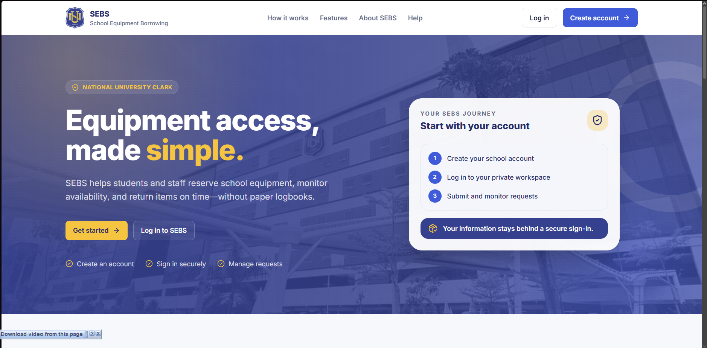
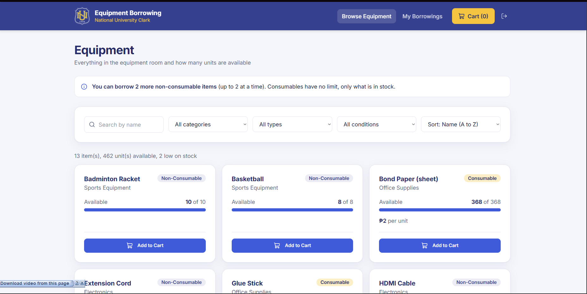
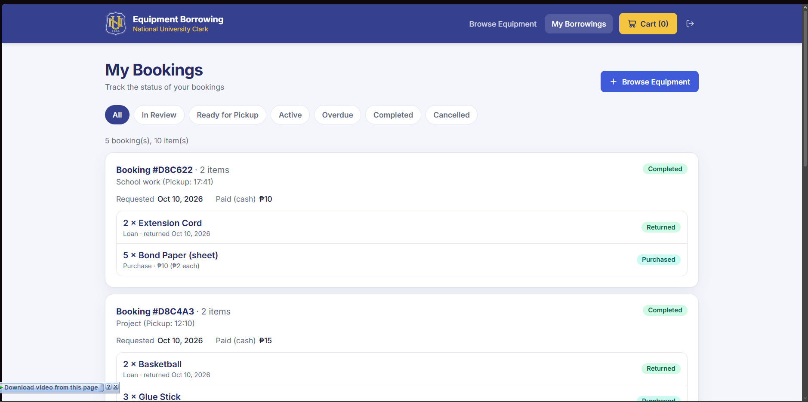
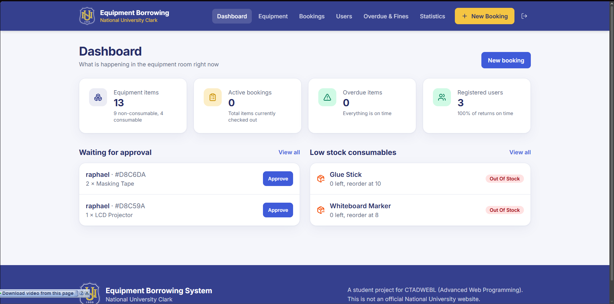
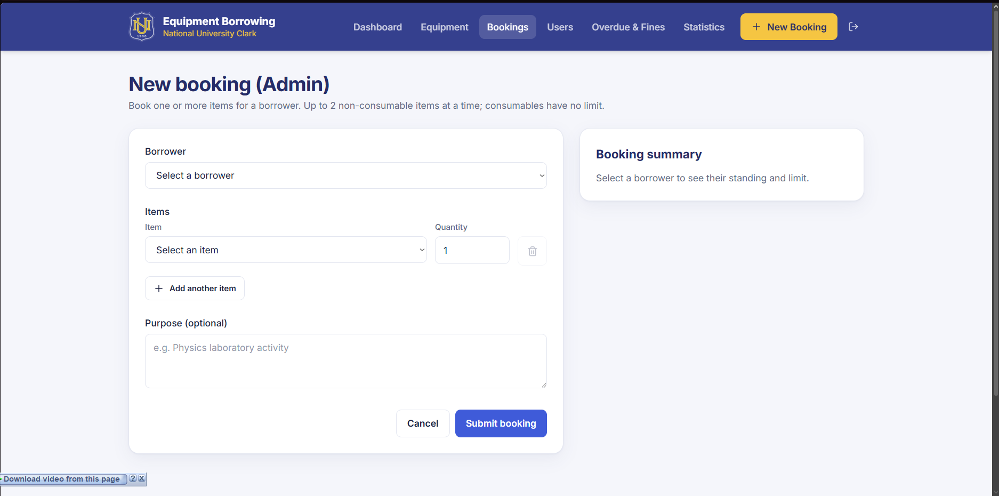
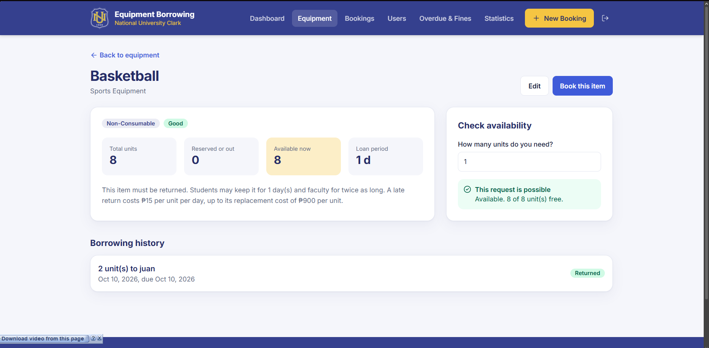
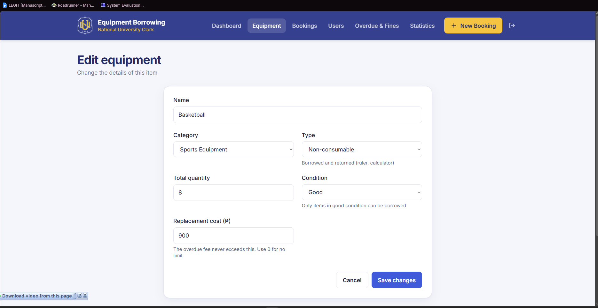
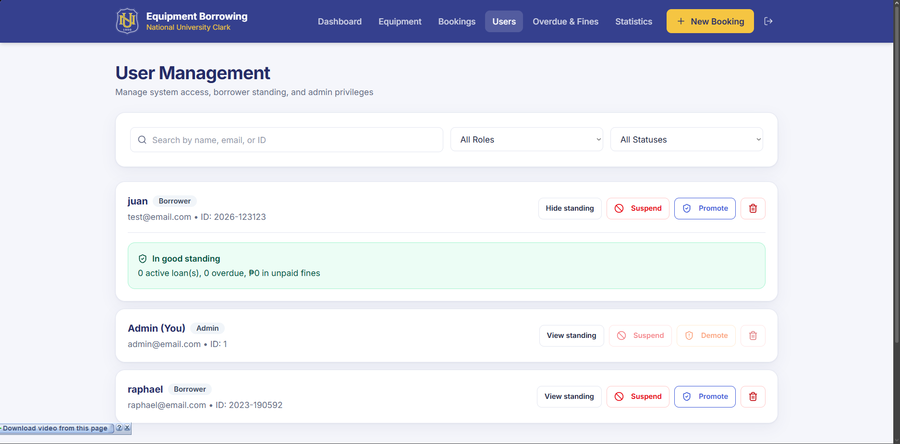
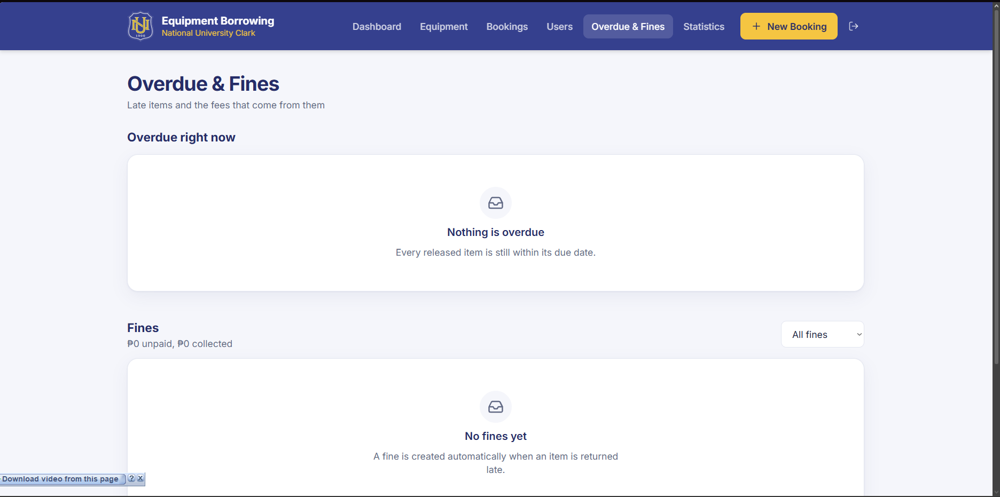
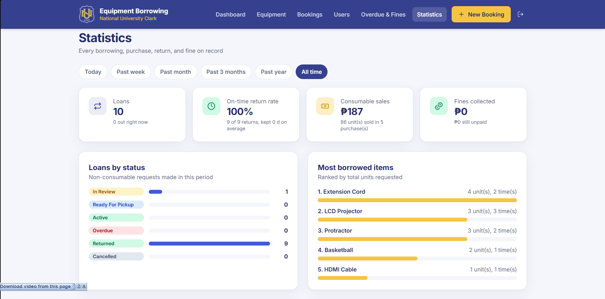

# School Equipment Borrowing System (SEBS)

SEBS replaces the paper logbook of a school equipment room. Students book equipment online, staff approve the bookings and hand the items over, and the system keeps track of what is available, what is due, who is late, and what has been sold.

Final project for **CTADWEBL (Advanced Web Programming)**, National University Clark, A.Y. 2026-2027.

> This is a student project. It is not an official National University website.

## Group members

- Asencio, Laurence
- Balatico, Aaron Justin
- Chuidian, Raphael
- Guevarra, Rancy

**Contents:** [Concept](#concept) · [What the application does](#what-the-application-does) · [Screenshots](#screenshots) · [Built with](#built-with) · [Setup](#setup) · [Environment variables](#environment-variables) · [API documentation](#api-documentation) · [Features](#features) · [Known limitations](#known-limitations)

## Concept

The equipment room lends out things like calculators, projectors, and sports balls, and it also sells supplies like bond paper and glue sticks. With a paper logbook it is hard to know what is still on the shelf, who has what, and who is late.

SEBS handles two kinds of items:

- **Non-consumables** are borrowed and must be returned by 9:00 PM on the due date. A late return creates a fine automatically.
- **Consumables** are bought with cash at pickup and kept. They are never returned, so the stock goes down when they are handed over.

There are two roles. **Borrowers** (students and faculty) book items. **Admins** (equipment-room staff) approve bookings, hand items over, take returns, and manage the inventory and accounts.

## What the application does

Every checkout becomes one **booking** that moves through these steps:

1. **Book.** The borrower adds items to the cart and checks out with a purpose, a pickup day (today or tomorrow), and a pickup time. The booking starts as *In Review*.
2. **Approve.** An admin approves it. It becomes *Ready for Pickup*, and its units are reserved so no one else can take them.
3. **Hand over.** At the counter, the admin hands the items over. Borrowed items become *Active* and are due at 9:00 PM on the pickup day. Consumables become *Purchased*: the cash is collected and the stock goes down.
4. **Return.** The admin marks borrowed items *Returned*, all at once or one at a time. A late item gets a fine automatically.

A booking can be cancelled before it is handed over: by the borrower while it is in review, or by an admin until pickup.

The server checks these rules on every booking:

- A borrower can have at most **2 non-consumable units** requested or borrowed at a time. Consumables are limited only by stock.
- A borrower with an unpaid fine, an overdue item, or an inactive profile cannot make new bookings.
- Damaged or retired items cannot be booked.
- Every item in a booking is checked first, and nothing is saved unless all of them pass.

### What data it processes

**Stored in MongoDB**

| Collection | What it holds |
|---|---|
| `users` | Login accounts: name, email, school ID, bcrypt password hash, role (`admin` or `borrower`), status (`active` or `suspended`) |
| `borrowers` | Borrowing profiles: school ID, name, email, type (`student` or `faculty`), status (`active` or `inactive`). Every new account gets one. |
| `categories` | Groups of equipment, each with a loan period in days and a daily late fee |
| `equipment` | Items: name, category, type, total quantity, reorder level, replacement cost, cost per unit, condition, damage notes |
| `borrowings` | One record per item in a booking: booking ID, item, borrower, quantity, purpose with pickup time, status, dates (requested, due, handed over, returned, purchased), unit and total price |
| `fines` | Late fees: the borrowing, the borrower, days late, amount, and whether it is paid |

**Computed by the server**

| Value | How it is worked out |
|---|---|
| Availability | Total quantity minus the units that are ready for pickup or out. Zero when the item is damaged or retired. |
| Due date | 9:00 PM on the pickup day the borrower chose |
| Days overdue | Days past the due date; any part of a day counts as a full day |
| Late fine | Days late × the category's daily fee × quantity, capped at the replacement cost × quantity |
| Borrower standing | Active loans, overdue items, unpaid fines, units left under the limit, and whether the borrower is blocked |
| Purchase total | Cost per unit × quantity. The price is saved with the booking, so a later price change does not rewrite past sales. |
| Low stock | Consumables at or below their reorder level |
| Statistics | Loans by status, on-time return rate, average loan length, most borrowed items, sales and top sellers, and fines, for a chosen period |

## Screenshots

<table>
  <tr>
    <td width="50%" valign="top"><b>Landing page</b><br><br><sub>Public home page with links to log in or create an account.</sub></td>
    <td width="50%" valign="top"><b>Browse equipment (borrower)</b><br><br><sub>Search and filter the inventory, see what is available, and add items to the cart. The 2-item limit is shown at the top.</sub></td>
  </tr>
  <tr>
    <td width="50%" valign="top"><b>My Bookings (borrower)</b><br><br><sub>Each checkout is one booking, with the status of every item and the cash paid for consumables.</sub></td>
    <td width="50%" valign="top"><b>Dashboard (admin)</b><br><br><sub>Counts at a glance, bookings waiting for approval, and consumables that are low or out of stock.</sub></td>
  </tr>
  <tr>
    <td width="50%" valign="top"><b>New booking (admin)</b><br><br><sub>Book several items for any borrower. The summary shows the borrower's standing and limit.</sub></td>
    <td width="50%" valign="top"><b>Equipment details (admin)</b><br><br><sub>Stock, loan rules, an availability checker, and the item's borrowing history.</sub></td>
  </tr>
  <tr>
    <td width="50%" valign="top"><b>Edit equipment (admin)</b><br><br><sub>Change an item's details, stock, condition, and replacement cost.</sub></td>
    <td width="50%" valign="top"><b>User management (admin)</b><br><br><sub>Search accounts, view a borrower's standing, suspend, promote or demote, and delete.</sub></td>
  </tr>
  <tr>
    <td width="50%" valign="top"><b>Overdue &amp; Fines (admin)</b><br><br><sub>Items past their due date with the running fee, and every fine with a paid or unpaid filter.</sub></td>
    <td width="50%" valign="top"><b>Statistics (admin)</b><br><br><sub>Loans, returns, sales, and fines, filtered by period.</sub></td>
  </tr>
</table>

## Built with

| Part | Tools |
|---|---|
| Frontend | React 19, TypeScript, Vite, Tailwind CSS 4, React Router 7, React Hook Form with Zod, axios, Lucide icons |
| Backend | Node.js, Express 5, Mongoose 8, bcryptjs, JSON Web Tokens, dotenv, cors |
| Database | MongoDB Atlas |

```
equipment-borrowing-system/
├── backend/               Express REST API
│   ├── app.js             entry point: middleware, routes, and starting the server
│   ├── config/            database connection and login-token secret
│   ├── controllers/       what each endpoint does
│   ├── middleware/        login check, request logger, 404, error handler
│   ├── models/            User, Borrower, Category, Equipment, Borrowing, Fine
│   ├── routes/            the URLs, one file per resource
│   ├── scripts/seed.js    sample data
│   └── utils/rules.js     the business rules in one place
├── frontend/              React app
│   ├── src/pages/         one file per page
│   ├── src/components/    shared parts: layout, route guard, dialogs, badges
│   ├── src/api/axios.ts   the API client
│   └── screenshots/       the images in this README
└── start.bat              Windows shortcut that starts both servers
```

## Setup

**You need:** Node.js 20.19+ or 22.12+ (we use Node 24), Git, and a MongoDB database (a free MongoDB Atlas cluster works).

**1. Get the code**

```bash
git clone https://github.com/Aaron6204/equipment-borrowing-system.git
cd equipment-borrowing-system
```

**2. Start the backend** (first terminal)

```bash
cd backend
npm install
copy .env.example .env     # Windows (macOS/Linux: cp .env.example .env)
```

Open `backend/.env` and fill in `MONGO_URI` and `JWT_SECRET` (see [Environment variables](#environment-variables)). Then:

```bash
npm run seed     # optional, first time only: loads sample data
npm run dev
```

The API runs at http://localhost:5000, and the terminal prints `MongoDB connected`.

> [!WARNING]
> `npm run seed` deletes all categories, equipment, borrower profiles, bookings, and fines, then loads sample data (13 items, 8 sample borrowers, 18 bookings, 2 fines). It does not create or delete login accounts. Run it only on a new, empty database: it also deletes the borrower profiles of accounts that already registered, and those accounts can no longer book. The sample borrowers have no login; admins can book for them from **New Booking**.

**3. Start the frontend** (second terminal)

```bash
cd frontend
npm install
npm run dev
```

Open http://localhost:5173.

**4. Make the first admin**

New accounts are always borrowers, and there is no admin sign-up.

1. Create an account on the site.
2. In MongoDB Atlas, open your cluster's **Browse Collections**, go to the `users` collection, edit your account, change `role` from `"borrower"` to `"admin"`, and save.
3. Log out and log in again. From then on, admins can promote other accounts on the **Users** page.

**Shortcuts**

- **Windows:** `start.bat` opens both servers and the browser. Edit the `PROJECT` path on its second line first; it points to the folder on the computer where it was made.
- **Phone on the same Wi-Fi:** set `CLIENT_URL=*` in `backend/.env`, then open the **Network** address that Vite prints (for example `http://192.168.1.5:5173`). If the page says it cannot reach the server, allow Node.js through the computer's firewall.

### Environment variables

Both `.env` files are ignored by Git. Never commit real passwords or connection strings.

**`backend/.env`**

```env
PORT=5000
MONGO_URI=mongodb+srv://<db-user>:<db-password>@<cluster>.mongodb.net/equipment-borrowing?retryWrites=true&w=majority
JWT_SECRET=<a long random string>
CLIENT_URL=http://localhost:5173
```

| Variable | Purpose |
|---|---|
| `MONGO_URI` | **Required.** MongoDB connection string. Use a database user from Atlas → Database Access, not your Atlas login. Put the database name (`equipment-borrowing`) before the `?`, or the data goes into a database called `test`. |
| `JWT_SECRET` | **Required.** Secret that signs login tokens. Make one with `node -e "console.log(require('crypto').randomBytes(48).toString('hex'))"`. During development the server can run without it, but then it makes a new random secret each time it starts, so existing logins stop working after a restart. |
| `PORT` | Optional. Port of the API. Default: `5000`. |
| `CLIENT_URL` | Optional. Frontend addresses allowed to call the API (CORS), separated by commas, or `*` for any. Default: `*`. |
| `DNS_SERVERS` | Optional. DNS servers to use, for example `8.8.8.8,1.1.1.1`, on networks that cannot look up Atlas addresses. Leave it out otherwise. |
| `NODE_ENV` | Optional. When set to `production`, `JWT_SECRET` must be set or logins fail. |

**`frontend/.env`** (optional)

| Variable | Purpose |
|---|---|
| `VITE_API_URL` | Optional. Base URL of the API, for example `http://localhost:5000/api`. If it is not set, the app calls port 5000 on the same computer that serves the page, which also works from a phone on the same Wi-Fi. |

### Troubleshooting

| Problem | Fix |
|---|---|
| `bad auth : authentication failed` | `MONGO_URI` needs a database user from Atlas → Database Access, not your Atlas login. Check the password. |
| `Could not connect to any servers in your MongoDB Atlas cluster` | Add your IP address in Atlas → Network Access. |
| `querySrv ECONNREFUSED` or `querySrv ENOTFOUND` | Set `DNS_SERVERS=8.8.8.8,1.1.1.1` in `backend/.env`. |
| The data shows up in a database called `test` | Add `/equipment-borrowing` before the `?` in `MONGO_URI`. |
| Vite fails with `Cannot find native binding` | Update Node.js (see **You need** above), delete `frontend/node_modules`, and run `npm install` again. |
| The site says it cannot reach the server | Start the backend first and check that it printed `MongoDB connected`. |

## API documentation

### Backend (Express REST API)

Base URL: `http://localhost:5000/api`. Opening `http://localhost:5000/` shows a short message when the API is running.

Every endpoint except register and login needs the token from login, sent as `Authorization: Bearer <token>`. Errors always come back as `{ "message": "..." }`. Admin-only actions are limited to admins by the frontend; the API itself only checks that you are logged in (see [Known limitations](#known-limitations)).

#### Auth

| Endpoint | Purpose |
|---|---|
| `POST /api/auth/register` | Create an account (name, school ID, email, and a password of at least 8 characters) together with its borrower profile. Returns a token. |
| `POST /api/auth/login` | Log in with email and password. Returns a token that lasts 8 hours, plus the user's role. |
| `GET /api/auth/me` | Get the logged-in user. |

#### Equipment

| Endpoint | Purpose |
|---|---|
| `GET /api/equipment` | List items with their availability. Optional query: `search`, `category`, `type`, `condition`, and `sort` (`name`, `totalQuantity`, `available`, or `createdAt`; put `-` in front for descending). |
| `GET /api/equipment/low-stock` | Consumables at or below their reorder level. |
| `GET /api/equipment/:id` | One item with its availability. |
| `GET /api/equipment/:id/availability?quantity=` | Check whether a quantity can be booked right now, and the reason if it cannot. |
| `POST /api/equipment` | Add an item. |
| `PUT /api/equipment/:id` | Edit an item. The quantity cannot go below the units that are out, and a damaged item needs damage notes. |
| `DELETE /api/equipment/:id` | Delete an item. |

#### Categories

| Endpoint | Purpose |
|---|---|
| `GET /api/categories` | List categories with their loan days and daily late fee. |
| `GET /api/categories/:id` | One category. |
| `POST /api/categories` | Add a category. |
| `PUT /api/categories/:id` | Edit a category. |
| `DELETE /api/categories/:id` | Delete a category. Blocked while equipment uses it. |

#### Borrowers

| Endpoint | Purpose |
|---|---|
| `GET /api/borrowers` | List borrower profiles. Optional `search` by name or school ID. |
| `GET /api/borrowers/:id` | One borrower profile. |
| `GET /api/borrowers/:id/standing` | The borrower's standing: active loans, overdue items, unpaid fines, units left under the 2-item limit, and whether they are blocked. |
| `POST /api/borrowers` | Add a borrower profile. |
| `PUT /api/borrowers/:id` | Edit a borrower profile, for example student or faculty, active or inactive. |
| `DELETE /api/borrowers/:id` | Delete a borrower profile. Blocked while they have unpaid fines. |

#### Bookings

| Endpoint | Purpose |
|---|---|
| `GET /api/borrowings` | List booked items with their days overdue. Optional query: `status`, `borrower` (a user ID or a borrower ID), and `equipment`. |
| `GET /api/borrowings/overdue` | Items out past their due date, with days late and the running fee. |
| `GET /api/borrowings/:id` | One booked item. |
| `POST /api/borrowings/batch` | Create one booking with several items. Checks the borrower's standing, the stock, and the 2-item limit for every item, then saves all of them or none. Used by checkout and by the admin booking form. |
| `POST /api/borrowings` | Create a booking with a single item. |
| `PUT /api/borrowings/:id` | Change the quantity or purpose of an item that is still in review. |
| `PATCH /api/borrowings/:id/status` | Move one item to its next status, for example to return a single item. Creates a fine when a loan comes back late. |
| `PATCH /api/borrowings/bookings/:bookingId/status` | Move a whole booking with `{ "action": "..." }`: `approve`, `handover` (loans become active and consumables are paid for), `return`, or `cancel`. |
| `DELETE /api/borrowings/:id` | Delete one item. Blocked while it is reserved or out, or while it has an unpaid fine. |
| `DELETE /api/borrowings/bookings/:bookingId` | Delete a whole booking, with the same rules. |

#### Fines

| Endpoint | Purpose |
|---|---|
| `GET /api/fines` | List fines. Optional `status` (`unpaid` or `paid`) and `borrower`. |
| `GET /api/fines/:id` | One fine. |
| `POST /api/fines` | Add a fine by hand. |
| `PUT /api/fines/:id` | Edit a fine or mark it paid. A paid fine cannot be changed. |
| `DELETE /api/fines/:id` | Delete a fine. |

#### Statistics

| Endpoint | Purpose |
|---|---|
| `GET /api/statistics?period=` | Totals, loans by status, on-time return rate, average loan length, most borrowed items, sales and top sellers, and fines. `period` is `today`, `week`, `month`, `quarter`, `year`, or `all` (the default). |

#### Users

| Endpoint | Purpose |
|---|---|
| `GET /api/users` | List accounts, without their password hashes. |
| `PATCH /api/users/:id/role` | Promote or demote an account: `{ "role": "admin" }` or `{ "role": "borrower" }`. |
| `PATCH /api/users/:id/status` | Suspend or reactivate an account: `{ "status": "suspended" }` or `{ "status": "active" }`. |
| `DELETE /api/users/:id` | Delete an account. |

### Frontend (React Router)

`/`, `/login`, and `/register` are public. Every other page needs a login, and the admin pages send borrowers back to `/equipment`.

| Route | Purpose |
|---|---|
| `/` | Landing page. |
| `/login` | Log in. Admins land on the dashboard and borrowers on the equipment list. |
| `/register` | Create a borrower account. |
| `/equipment` | Borrowers browse items and add them to the cart. Admins manage the inventory and categories. |
| `/borrowings/new` | Borrowers check out their cart. Admins book several items for any borrower. |
| `/borrowings` | Borrowers see **My Bookings**. Admins approve, hand over, return, cancel, and delete bookings. |
| `/dashboard` | Admin. Counts, bookings waiting for approval, and low-stock consumables. |
| `/equipment/new` | Admin. Add an item. |
| `/equipment/:id` | Admin. Item details, an availability checker, and the borrowing history. |
| `/equipment/:id/edit` | Admin. Edit an item. |
| `/users` | Admin. Manage accounts. |
| `/overdue` | Admin. Overdue items with running fees; record returns and mark fines paid. |
| `/statistics` | Admin. Statistics filtered by period. |
| Any other path | "Page not found" page. |

## Features

**For borrowers**

- Create an account with a school ID and email, and log in
- Browse, search, filter (category, type, condition), and sort the equipment, with live availability
- A cart that books several items at once, with the 2-item limit shown before checkout
- Checkout with a purpose, a pickup day and time, and the cash total for consumables
- **My Bookings:** one card per booking with each item's status, filters by status, and cancelling while in review

**For admins**

- **Dashboard:** equipment, active bookings, overdue items, and registered users at a glance; approve waiting bookings; see low-stock consumables
- **Bookings:** approve, hand over (collecting cash for consumables), return all items or one at a time, cancel, and delete
- **New booking** for any borrower, with several items and a live summary of their standing and limit
- **Equipment:** add, edit, and delete items; manage categories (loan days and daily late fee); track condition with damage notes; set the replacement cost, cost per unit, and reorder level
- **Equipment details:** an availability checker and the borrowing history
- **Overdue & Fines:** items past due with their running fee, recording returns, and marking fines paid
- **Users:** search and filter accounts, view standing, suspend or reactivate, promote or demote, and delete
- **Statistics:** loans, on-time return rate, most borrowed items, consumable sales, and fines, filtered by today, past week, past month, past 3 months, past year, or all time

**Under the hood**

- Passwords hashed with bcrypt; logins use JSON Web Tokens that last 8 hours
- Pages protected by login, and admin pages by role, in the frontend
- Business rules kept in one backend file (`backend/utils/rules.js`) and checked on the server
- Bookings saved all or nothing; stock checked again on approval and at handover, so two sales cannot take the last unit
- Guards that keep records consistent: a category with equipment cannot be deleted, stock cannot drop below the units that are out, a booking cannot be deleted while it is reserved or out or has an unpaid fine, and a paid fine cannot be edited
- One axios instance that adds the login token to every request and turns server errors into readable messages
- Forms validated with React Hook Form and Zod, with an error under each field
- Loading, empty, and error states; success and error messages; a confirmation step before every delete
- Responsive layout with a menu button on small screens

## Known limitations

- **Role checks happen only in the frontend.** The API checks that a user is logged in but not whether they are an admin, so any logged-in account could call admin endpoints (for example, changing roles) directly.
- **Suspension is not enforced by the API.** A suspended borrower sees a notice and cannot add items to the cart, but only after logging in again, and the API still accepts their requests.
- **Deleting an item or a borrower profile is not blocked while it has open bookings.** The checks in `equipmentController.js` and `borrowerController.js` still look for the old status names (`pending`, `approved`, `released`).
- **The loan length is fixed.** Every loan is due at 9:00 PM on the pickup day. The category's loan days and the longer faculty period are still shown on the equipment page but are not used for the due date.
- **No reservations by date.** Pickup can only be today or tomorrow, the pickup time is saved as text inside the purpose, and availability is for the present moment.
- **The first admin is set by hand** in the database. New accounts are always students, and there is no screen to mark a borrower as faculty.
- **The cart is not saved.** Refreshing the page empties it.
- **No online payment.** Consumables are paid in cash at pickup, and fines are marked paid by hand.
- **No password reset or email verification.** The login token is kept in the browser's local storage and lasts 8 hours.
- **No live updates.** Pages do not refresh by themselves when someone else changes the data.
